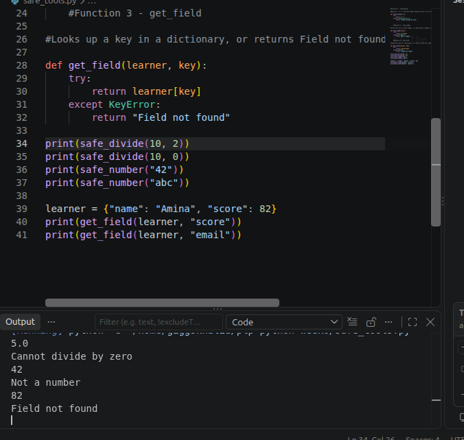

# PLP Python Week 6

## Assignment Title

**Safe Functions and Exception Handling**

## Project Description

This project demonstrates how Python exception handling can be used to prevent programs from crashing when unexpected errors occur.

## Files

* **`safe_tools.py`** - Contains three safe functions: `safe_divide()`, `safe_number()`, and `get_field()`. The functions use `try/except` to safely handle errors such as division by zero, invalid number conversion, and missing dictionary keys.
* **`unbreakable.py`** - Contains the additional exception-handling exercise for the assignment.
* **`README.md`** - Provides information about the assignment, project files, and exception handling.

## Safe Functions

The `safe_tools.py` file contains three functions:

### 1. `safe_divide()`

Divides one number by another and returns `"Cannot divide by zero"` when the second number is zero.

### 2. `safe_number()`

Converts text into a whole number using `int()`. If the text cannot be converted into a number, it returns `"Not a number"`.

### 3. `get_field()`

Looks up a key in a dictionary. If the requested key does not exist, it returns `"Field not found"`.

## Why can the `if` check not catch `abc` on its own?

An `if` check can test whether a condition is true, but it cannot catch the `ValueError` that occurs when Python tries to convert `"abc"` into an integer using `int()`. The `try/except` block is needed to catch the `ValueError` and return `"Not a number"` instead of allowing the program to crash.

## Expected Output

The `safe_tools.py` program produces the following output:

```text
5.0
Cannot divide by zero
42
Not a number
82
Field not found
```

## Program Output Screenshot



## Exception Handling

This assignment demonstrates three common Python exceptions:

* **`ZeroDivisionError`** - occurs when attempting to divide a number by zero.
* **`ValueError`** - occurs when a value cannot be converted to the required type, such as converting `"abc"` to an integer.
* **`KeyError`** - occurs when trying to access a dictionary key that does not exist.

Using `try` and `except` allows the program to handle these errors safely without crashing.
